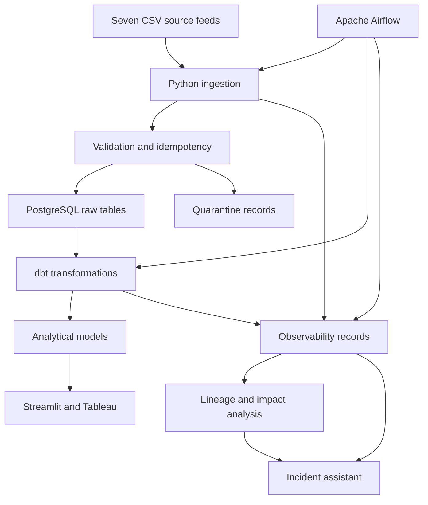

# AI-Assisted Data Quality, Observability and Incident Management Platform

A production-oriented e-commerce data platform that ingests incremental source
files, validates data quality, quarantines invalid records, builds tested
analytical models, tracks operational incidents, maps downstream lineage and
provides evidence-grounded incident investigation.

## Business problem

E-commerce reporting depends on customer, product, order, payment, shipment
and inventory data arriving correctly and on time. Missing files, schema
changes, duplicate identifiers, invalid values and broken relationships can
silently produce unreliable business KPIs.

This platform detects these problems across ingestion, transformation and
orchestration layers and preserves the evidence required for investigation.

## Key capabilities

- Incremental ingestion of seven e-commerce source feeds
- File-checksum-based idempotency
- Filename, schema and business-rule validation
- Invalid-record quarantine with row-level evidence
- PostgreSQL raw, analytical, observability and quarantine schemas
- dbt staging, dimensional and reporting models
- Automated dbt quality, relationship and reconciliation tests
- Apache Airflow orchestration with retry and failure handling
- Reproducible failure injection and incident tracking
- Pipeline, task and data-quality observability
- OpenLineage event integration
- Lineage-based downstream impact analysis
- Streamlit engineering and incident dashboards
- Tableau stakeholder dashboards
- Evidence-grounded incident-assistant API
- Unsupported-question refusal and evidence citations
- Unit, integration and end-to-end tests
- Docker Compose and GitHub Actions validation

## Architecture



## Data flow

1. Airflow discovers source files for a batch.
2. Filename and required-file checks run before ingestion.
3. Python validates schemas, required fields and business rules.
4. Valid records are loaded into PostgreSQL raw tables.
5. Invalid records are stored in the quarantine schema with failure evidence.
6. File checksums prevent duplicate ingestion during reruns.
7. dbt creates staging, dimensional and analytical models.
8. dbt tests validate uniqueness, nullability, accepted values, relationships
   and business reconciliations.
9. Pipeline, task and quality results are recorded in observability tables.
10. Incidents are linked to experiments, evidence and downstream assets.
11. Streamlit, Tableau and the incident assistant expose operational results.

## Technology stack

| Area | Technology |
|---|---|
| Programming | Python, SQL |
| Data processing | pandas |
| Database | PostgreSQL |
| Database access | SQLAlchemy, psycopg2 |
| Transformation | dbt, dbt-postgres |
| Orchestration | Apache Airflow |
| Data quality | Python validation, dbt tests, reconciliation checks |
| Observability | PostgreSQL metadata, Airflow events, OpenLineage |
| API | FastAPI, Uvicorn |
| Engineering dashboard | Streamlit, Plotly |
| Stakeholder reporting | Tableau |
| Containers | Docker, Docker Compose |
| Testing | pytest, pytest-cov |
| Code quality | Ruff |
| CI/CD | GitHub Actions |

## Repository structure

```text
.
├── airflow/                  Airflow configuration and DAGs
├── assistant/                Evidence retrieval, question routing and API
├── configs/                  Project configuration
├── dashboard/                Streamlit observability application
├── data/                     Generated, incoming and archived source data
├── database/init/            PostgreSQL schema initialization
├── dbt_project/              dbt models, tests and profiles
├── docs/                     Documentation and measured results
├── ingestion/                Discovery, validation and loading pipeline
├── observability/            Incidents, quality and lineage services
├── scripts/                  Supporting execution scripts
├── tests/                    Unit, integration and end-to-end tests
├── docker-compose.yml        Core service configuration
└── docker-compose.apps.yml   FastAPI and Streamlit application services
```

## Database layers

| Schema | Purpose |
|---|---|
| `raw` | Validated source records |
| `staging` | dbt-cleaned and standardized data |
| `analytics` | Dimensional models and business reporting tables |
| `observability` | Pipeline runs, tests, incidents, experiments and lineage |
| `quarantine` | Invalid source records and failure evidence |

The implemented database contains:

- 7 raw tables
- 7 analytical tables
- 9 observability tables
- 1 quarantine table

## Failure scenarios

The project implements 11 reproducible failure experiments, including:

- Missing required batch files
- Source schema contract violations
- Duplicate order identifiers
- Missing customer identifiers
- Unsupported order statuses
- Negative payment values
- Referential-integrity failures
- Order-total reconciliation failures
- Delivery-delay violations
- Abnormal daily order volume

Failure experiments record the expected detection layer, severity, timestamps,
detection status and time to detection.

## Measured results

Measurements were recorded on 6 August 2026 using Git commit
`4a116a7442a79761760e7b1cbec0d49d58f72976`.

| Metric | Result |
|---|---:|
| Source entity feeds | 7 |
| Deduplicated records processed | 21,432 |
| Raw and analytical tables | 14 |
| dbt models | 18 |
| Automated dbt tests | 60 |
| Python tests | 38 passed |
| Assistant-package coverage | 77.90% |
| Full-codebase coverage baseline | 23.36% |
| Failure experiments | 11 |
| Injected failures detected | 11 of 11 |
| Failure-detection rate | 100.00% |
| Lineage assets mapped | 96 |
| Lineage edges mapped | 102 |
| Average local pipeline runtime | 0.14 seconds |
| Assistant evaluation questions | 25 |
| Assistant evaluation pass rate | 100.00% |
| Assistant citation accuracy | 100.00% |
| Unsupported-claim rate | 0.00% |
| Manual investigation time | 14.88 minutes |
| Assistant-assisted investigation time | 9.73 minutes |
| Investigation-time reduction | 34.60% |

Detailed definitions, commands and limitations are available in
[`docs/results/final_results.md`](docs/results/final_results.md).

## Investigation assistant

The assistant retrieves evidence from:

- `observability.incidents`
- `observability.quality_test_results`
- `observability.airflow_task_events`
- `observability.incident_impacted_assets`
- `observability.lineage_assets`
- Historical incident records

Responses contain:

- Incident summary
- Confirmed evidence
- Likely causes or hypotheses
- Affected assets
- Recommended investigation steps
- Confidence level
- Limitations
- Evidence citations

The assistant refuses unsupported requests rather than inventing evidence.

## Local setup

### Prerequisites

Install:

- Git
- Python 3.13
- Docker Desktop
- dbt-postgres

Clone the repository and enter the project:

```bash
git clone <repository-url>
cd data-observability-platform
```

Create and activate a virtual environment:

```bash
python3 -m venv .venv
source .venv/bin/activate
```

Install project dependencies:

```bash
python -m pip install --upgrade pip
python -m pip install -r requirements.txt
python -m pip install -r requirements-app.txt
```

Create the environment file:

```bash
cp .env.example .env
```

Review `.env` and provide local development values before starting services.

## Start the containerized applications

Make sure Docker Desktop is running:

```bash
docker info
```

Build and start PostgreSQL, FastAPI and Streamlit:

```bash
docker compose \
  -f docker-compose.yml \
  -f docker-compose.apps.yml \
  up -d \
  --build \
  postgres \
  incident-api \
  observability-dashboard
```

Check service status:

```bash
docker compose \
  -f docker-compose.yml \
  -f docker-compose.apps.yml \
  ps
```

Application endpoints:

| Application | URL |
|---|---|
| Incident API health | `http://localhost:8000/health` |
| FastAPI documentation | `http://localhost:8000/docs` |
| Streamlit dashboard | `http://localhost:8501` |
| Streamlit health | `http://localhost:8501/_stcore/health` |

## Run the ingestion pipeline

From the repository root:

```bash
python -m ingestion.run_pipeline
```

## Run dbt

```bash
cd dbt_project
dbt debug --profiles-dir .
dbt build --profiles-dir .
cd ..
```

## Test the incident API

Health check:

```bash
curl --fail --silent \
  http://localhost:8000/health \
  | python -m json.tool
```

List incidents:

```bash
curl --fail --silent \
  "http://localhost:8000/api/v1/incidents?limit=5" \
  | python -m json.tool
```

Retrieve incident evidence:

```bash
curl --fail --silent \
  "http://localhost:8000/api/v1/incidents/<incident-id>/evidence" \
  | python -m json.tool
```

Ask an evidence-grounded question:

```bash
curl --fail --silent \
  -X POST \
  "http://localhost:8000/api/v1/incidents/<incident-id>/questions" \
  -H "Content-Type: application/json" \
  -d '{
    "question": "What rule failed and what evidence confirms it?"
  }' \
  | python -m json.tool
```

## Testing and quality checks

Run Ruff:

```bash
python -m ruff check \
  assistant \
  ingestion \
  observability \
  tests
```

Run the complete test suite and configured coverage gate:

```bash
python -m pytest \
  --cov=assistant \
  --cov-config=.coveragerc \
  --cov-report=term-missing \
  --cov-report=xml:coverage.xml \
  --cov-fail-under=60
```

Verified result:

```text
38 passed
Required test coverage of 60% reached
Total assistant-package coverage: 77.90%
```

## Reproducibility evidence

Measured outputs are stored under:

```text
docs/results/evidence/
```

This includes:

- Database metrics
- dbt resource counts
- pytest and coverage reports
- Assistant evaluation results
- Failure-experiment evidence
- Manual and assisted investigation records
- Investigation-time comparison
- Experiment date and Git commit

## Accuracy and limitations

- The seven sources are entity feeds; the implemented source-file format is CSV.
- The 100% detection result applies only to the 11 implemented experiments.
- The 77.90% coverage result applies to the configured `assistant` package.
- The broader full-codebase coverage baseline is 23.36%.
- Assistant evaluation used a controlled set of 25 questions.
- Investigation time was measured using one comparable incident pair.
- Runtime results were measured locally using a synthetic dataset.
- Cloud deployment is not included in the current implementation.

## Future improvements

- Add unit and integration coverage for ingestion and observability modules
- Add JSON and Parquet ingestion adapters
- Repeat investigation timing across additional incident pairs
- Add production authentication and role-based authorization
- Add external alerting through email or collaboration platforms
- Deploy the platform to a managed cloud environment
- Add historical data-drift and anomaly-detection models

## Documentation

- [Final measured results](docs/results/final_results.md)
- [Investigation experiment protocol](docs/results/investigation_protocol.md)
- [Local deployment guide](docs/local_deployment.md)

## License

This project is intended for educational and portfolio use.